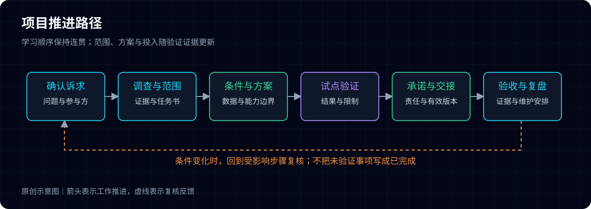

# 第01篇 客户说“想做智能运维”，先别急着讲方案

**客户刚坐下就说：“我们想做智能运维，你们有什么方案？”**

**你已经准备好了平台图、功能清单和案例介绍。但如果现在就开始讲，可能直到交流结束，你仍不知道：对方究竟想解决什么，下一次会不会继续推进。**

**先别急着翻方案。问清楚一次具体事件，才能判断对方缺的是工具、数据，还是处理问题时找不到人。**

> 文中场景和数字仅作示例，不代表真实项目或实际效果。

先约定一个例子：某银行的交易查询服务在繁忙时段偶发超时。监控和日志工具都有，值班人员仍要联系几个团队，才能确认影响和责任。后面的讨论就从这件事展开。

## 先问发生了什么，再问希望建设什么

假设对方这样描述：“告警比较多，领导希望做一些智能化。”

直接追问希望购买哪些模块，往往只能得到另一份功能清单。更有用的下一问是：“能否选最近一次处理起来比较费力的事件，讲讲从发现到恢复的过程？”

这不是要求对方当场提供完整复盘。先确认最基本的事实：谁先发现、看到了什么、采取了什么动作、在哪一步停下来。若涉及敏感记录，只约定后续由客户在授权范围内整理脱敏样本，不临时索取生产账号、完整工单或交易明细。

如果值班人员最费力的是找人，仅仅减少告警数量，未必能帮上忙。还得查清对象归谁管、与哪些业务有关，以及什么时候需要升级处理。问题问得不同，方案就会不同。

问题必须由证据逐步确认。首次交流获得的是调查方向，不能把初步解释写成已经证实的根因。

## 把四类信息分开记录

交流笔记最常见的缺陷，是将客户说法、观察事实和自己的推断混在一起。例如，“现有平台不支持关联”可能只是某位使用者未找到入口，未必是平台没有能力。

现场可以按下面四类信息记笔记。不清楚的先留待确认，不必为了填满表格勉强下结论。

| 信息类别 | 需要确认的问题 | 填写示例 | 下一步证据 |
|---|---|---|---|
| 工作问题 | 哪项工作受阻，影响谁 | 值班人员需跨团队核对查询异常 | 脱敏事件过程与使用者说明 |
| 当前做法 | 现有工具和人工如何配合 | 先看告警，再查日志，再联系应用团队 | 演示一次现有工作过程 |
| 预期改变 | 具体希望少做什么或多知道什么 | 在联系团队前看清对象归属和异常线索 | 与使用者确认输出样例 |
| 项目条件 | 谁推动、处于何阶段、下次决定什么 | 目前为需求调查，尚未确认范围 | 项目负责人确认后续参与者 |

每条记录另外标注状态：已观察、对方描述、初步推断或待确认。记录“对方描述”并不否定其价值，而是提示后续还需核对。

## 识别参与方，避免只向一个人确认全部需求

一个项目通常涉及提出目标的人、使用工具的人、维护工具的人、提供数据的人和组织实施的人。同一人可以承担多个角色，但不同责任不能因此消失。

示例场景中的值班人员能解释操作困难，应用团队能解释日志含义，平台维护人员能确认接口和接入条件，建设负责人负责协调范围。若只与建设负责人交流，可能得到清晰目标，却遗漏数据取不到的问题；若只与一线人员交流，则可能知道许多细节，却无法确认优先级和资源安排。

先按职责记人：值班负责人、应用接口负责人、建设负责人。具体由谁承担，请客户内部确认。只要能找到该确认问题的人，就没有必要追问与项目无关的私人关系。

| 角色 | 本轮应确认什么 | 暂时不能替其他角色决定什么 |
|---|---|---|
| 使用团队 | 工作步骤、困难、可接受的输出 | 数据接口能否开通 |
| 数据与工具维护方 | 数据含义、能力、权限和维护条件 | 项目整体价值排序 |
| 建设负责人 | 目标、范围确认路径和资源协调 | 尚未测试的技术效果 |
| 实施负责人 | 工作分解、依赖和交接条件 | 未经确认的新增承诺 |

## 搞清当前要作什么决定

“项目有预算吗”是一个问题，但不能代替了解项目阶段。有人是在收集方向，有人要准备建设说明，有人已经有技术要求，还有人需要验证既有方案。

因此，应具体询问下一次要形成什么结论：确定是否开展调研、选择试点场景、判断数据可行性，还是确认测试计划。不同结论需要不同材料。尚未选定场景时就写详细验收条款，容易把未经证实的假设固定下来；即将测试时还只谈行业趋势，则无法推进。

项目阶段也不是固定直线。先立项后验证、先小范围验证再确定建设范围，都可能出现。首次交流应记录真实路径，而不是要求对方符合一张预设流程图。

项目不一定按图中顺序直线推进。样本变了、接口条件变了，前面定过的范围和估算就要回头检查。

## 用一项小行动结束交流

一次有效交流不一定当场确定方案，但应形成明确的后续动作。例如，由使用团队整理一段脱敏事件过程，由维护方说明两类数据的获取条件，项目双方再基于样本确定调研范围。

动作需要四个要素：谁负责、交付什么、何时确认、它用于回答哪个问题。避免只记录“后续再交流”，也不要把尚未安排资源的建议写成承诺。

对于示例场景，首次交流的合理结论可以是：问题值得进一步调查，具体异常位置和告警有效性尚未确认；下一轮需要值班、应用和工具维护角色共同还原一次事件。这样的结论虽然保留不确定性，却能直接指导工作。

会议结束前，至少把问题、参与者和下一次要确认的事项记清楚。如果仍只有一句“后面再聊”，这次交流就还没有安排好下一步。

