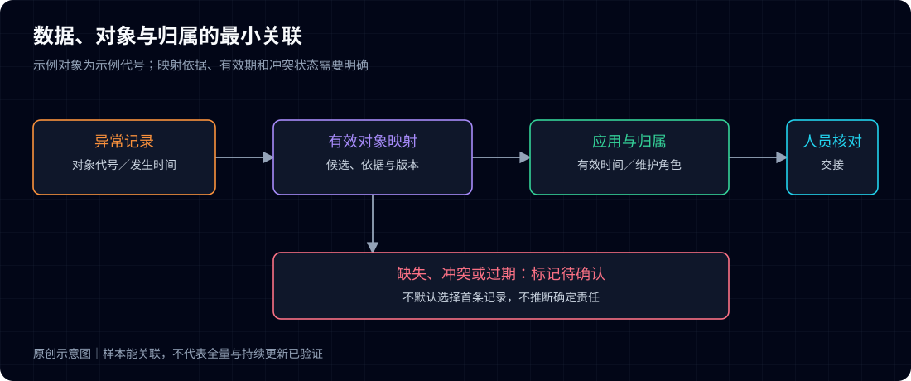
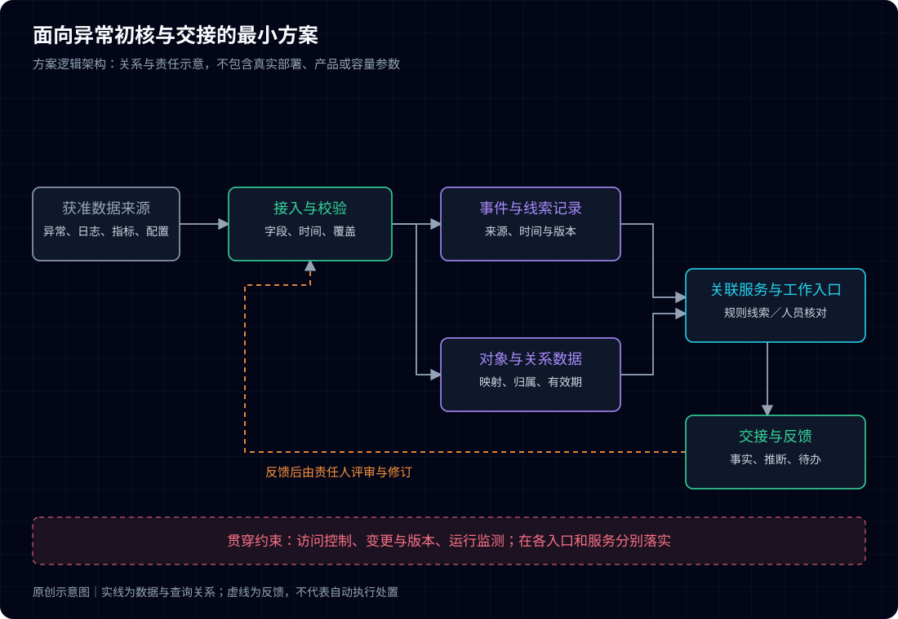
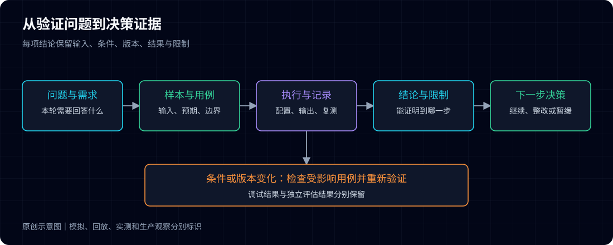
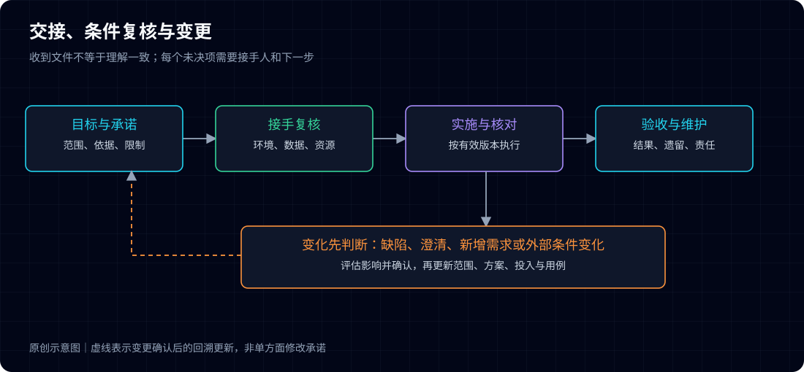

# 金融智能运维项目实战

## 从需求调研到POC与交付

文中场景和数字仅作示例，不代表真实项目结果。

---

# 第01篇 客户说“想做智能运维”，先别急着讲方案

**客户刚坐下就说：“我们想做智能运维，你们有什么方案？”**

**你已经准备好了平台图、功能清单和案例介绍。但如果现在就开始讲，可能直到交流结束，你仍不知道：对方究竟想解决什么，下一次会不会继续推进。**

**先别急着翻方案。问清楚一次具体事件，才能判断对方缺的是工具、数据，还是处理问题时找不到人。**

> 文中场景和数字仅作示例，不代表真实项目或实际效果。

先约定一个例子：某银行的交易查询服务在繁忙时段偶发超时。监控和日志工具都有，值班人员仍要联系几个团队，才能确认影响和责任。后面的讨论就从这件事展开。

## 先问发生了什么，再问希望建设什么

假设对方这样描述：“告警比较多，领导希望做一些智能化。”

直接追问希望购买哪些模块，往往只能得到另一份功能清单。更有用的下一问是：“能否选最近一次处理起来比较费力的事件，讲讲从发现到恢复的过程？”

这不是要求对方当场提供完整复盘。先确认最基本的事实：谁先发现、看到了什么、采取了什么动作、在哪一步停下来。若涉及敏感记录，只约定后续由客户在授权范围内整理脱敏样本，不临时索取生产账号、完整工单或交易明细。

如果值班人员最费力的是找人，仅仅减少告警数量，未必能帮上忙。还得查清对象归谁管、与哪些业务有关，以及什么时候需要升级处理。问题问得不同，方案就会不同。

问题必须由证据逐步确认。首次交流获得的是调查方向，不能把初步解释写成已经证实的根因。

## 把四类信息分开记录

交流笔记最常见的缺陷，是将客户说法、观察事实和自己的推断混在一起。例如，“现有平台不支持关联”可能只是某位使用者未找到入口，未必是平台没有能力。

现场可以按下面四类信息记笔记。不清楚的先留待确认，不必为了填满表格勉强下结论。

| 信息类别 | 需要确认的问题 | 填写示例 | 下一步证据 |
|---|---|---|---|
| 工作问题 | 哪项工作受阻，影响谁 | 值班人员需跨团队核对查询异常 | 脱敏事件过程与使用者说明 |
| 当前做法 | 现有工具和人工如何配合 | 先看告警，再查日志，再联系应用团队 | 演示一次现有工作过程 |
| 预期改变 | 具体希望少做什么或多知道什么 | 在联系团队前看清对象归属和异常线索 | 与使用者确认输出样例 |
| 项目条件 | 谁推动、处于何阶段、下次决定什么 | 目前为需求调查，尚未确认范围 | 项目负责人确认后续参与者 |

每条记录另外标注状态：已观察、对方描述、初步推断或待确认。记录“对方描述”并不否定其价值，而是提示后续还需核对。

## 识别参与方，避免只向一个人确认全部需求

一个项目通常涉及提出目标的人、使用工具的人、维护工具的人、提供数据的人和组织实施的人。同一人可以承担多个角色，但不同责任不能因此消失。

示例场景中的值班人员能解释操作困难，应用团队能解释日志含义，平台维护人员能确认接口和接入条件，建设负责人负责协调范围。若只与建设负责人交流，可能得到清晰目标，却遗漏数据取不到的问题；若只与一线人员交流，则可能知道许多细节，却无法确认优先级和资源安排。

先按职责记人：值班负责人、应用接口负责人、建设负责人。具体由谁承担，请客户内部确认。只要能找到该确认问题的人，就没有必要追问与项目无关的私人关系。

| 角色 | 本轮应确认什么 | 暂时不能替其他角色决定什么 |
|---|---|---|
| 使用团队 | 工作步骤、困难、可接受的输出 | 数据接口能否开通 |
| 数据与工具维护方 | 数据含义、能力、权限和维护条件 | 项目整体价值排序 |
| 建设负责人 | 目标、范围确认路径和资源协调 | 尚未测试的技术效果 |
| 实施负责人 | 工作分解、依赖和交接条件 | 未经确认的新增承诺 |

## 搞清当前要作什么决定

“项目有预算吗”是一个问题，但不能代替了解项目阶段。有人是在收集方向，有人要准备建设说明，有人已经有技术要求，还有人需要验证既有方案。

因此，应具体询问下一次要形成什么结论：确定是否开展调研、选择试点场景、判断数据可行性，还是确认测试计划。不同结论需要不同材料。尚未选定场景时就写详细验收条款，容易把未经证实的假设固定下来；即将测试时还只谈行业趋势，则无法推进。

项目阶段也不是固定直线。先立项后验证、先小范围验证再确定建设范围，都可能出现。首次交流应记录真实路径，而不是要求对方符合一张预设流程图。

项目不一定按图中顺序直线推进。样本变了、接口条件变了，前面定过的范围和估算就要回头检查。

## 用一项小行动结束交流

一次有效交流不一定当场确定方案，但应形成明确的后续动作。例如，由使用团队整理一段脱敏事件过程，由维护方说明两类数据的获取条件，项目双方再基于样本确定调研范围。

动作需要四个要素：谁负责、交付什么、何时确认、它用于回答哪个问题。避免只记录“后续再交流”，也不要把尚未安排资源的建议写成承诺。

对于示例场景，首次交流的合理结论可以是：问题值得进一步调查，具体异常位置和告警有效性尚未确认；下一轮需要值班、应用和工具维护角色共同还原一次事件。这样的结论虽然保留不确定性，却能直接指导工作。

会议结束前，至少把问题、参与者和下一次要确认的事项记清楚。如果仍只有一句“后面再聊”，这次交流就还没有安排好下一步。

---

# 第02篇 别再问“需要什么功能”：沿着一次事件挖需求

**一轮调研结束，笔记上写满了“统一展示”“自动分析”“智能定位”。每个人都提了需求，真正开始写方案时，却仍不知道该先解决哪一步。**

**问题可能出在提问方式：你收集了大家想要的功能，却没有还原他们怎样完成工作。**

**换一种问法：选一次处理起来费力的事件，从第一条提示一直追到有人接手。功能清单背后的缺口，才开始变得具体。**

> 文中场景和数字仅作示例，不代表真实项目或实际效果。

## 选能讲清楚的事件，不选最戏剧化的事件

调研不必先找影响最大的故障。重大事件可能牵涉复杂背景，记录也未必便于共享。可以优先选择参与者仍记得过程、材料相对齐备、与试点有关的一次任务。

除了故障，也可选择一轮例行巡检、一次告警确认或一项容量核查。关键是任务有开始、有结束、有明确执行者，能够观察判断是怎样形成的。

先约定研究范围。例如，本轮只调查“从第一条异常提示出现，到责任团队接手”的过程，不立即扩展到修复代码和业务恢复。范围越明确，越容易得到能检验的结论。

## 让参与者沿时间线复述

访谈可以从“你当时先看到了什么”开始。每讲到一个动作，就继续追问：依据是什么，在哪个工具看到，为什么进入下一步，若没有这项信息会怎样处理。

先按发生顺序记，不急着解释原因。前面的查询异常，可以这样拆：

| 过程节点 | 输入与动作 | 当时需要作出的判断 | 发现的缺口 |
|---|---|---|---|
| 发现异常 | 收到查询耗时告警 | 是个别请求还是较广泛异常 | 缺少可直接查看的业务范围 |
| 初步核对 | 打开日志与监控页面 | 哪个应用或依赖先出现异常 | 页面对象名称不一致 |
| 联系团队 | 按历史经验寻找负责人 | 应由哪个团队先接手 | 对象归属信息未进入工作入口 |
| 团队接手 | 补充日志与指标 | 现有证据是否足够继续排查 | 缺少统一的交接信息要求 |

这张表没有宣称缺口已经被证实。它首先是一组待核对观察，需要通过实际演示、记录或其他角色的说明确认。

## 区分操作时间、等待时间与证据不足

“排障花了很久”是总体感受，不能直接推出需要新的算法。总耗时可能包含查数据、等待权限、寻找负责人、跨团队排队和实际技术分析。

调研时应把这些因素分开。操作繁琐可能通过入口整合改善；等待接口可能需要协调；缺少字段可能需要源系统改造；未知技术问题才可能需要更深的分析能力。

若记录带时间戳，可以在授权范围内计算各阶段耗时。没有可靠时间戳时，先写“顺序已确认、时长未确认”，不要让参与者的回忆变成看似精确的统计结果。

使用均值、中位数或分位数之前，还要说明样本来自哪些任务、是否包含等待、未完成事件怎样处理。一个事件可以帮助发现机制，不能代表整体平均水平。

## 金融场景还要问清业务时段与影响对象

同样是查询耗时增加，在低频内部查询、集中客户访问和批量处理期间，含义可能不同。调研需要由业务或应用角色说明任务在什么时候重要，当前记录怎样对应业务影响，不能由运维人员仅凭资源指标推定客户受损。

不同机构也应分别调查。银行项目可能需要核对联机与批量任务的关系；证券项目可能需要区分交易相关时段与其他时段；基金项目可能需要理解估值、清算或文件处理任务的依赖。这些是访谈方向，不代表所有机构采用相同流程或窗口。

在问题清单中补充“适用时段、影响对象、确认角色和证据范围”。若当前只能确认技术异常，就记录技术异常，把业务影响保留为待确认，而不是在建设说明中扩大表述。

## 同一个问题至少从两个位置看

使用者说“数据查不到”，维护方可能说明数据存在，只是对象标识不同。维护方说“接口已提供”，使用者可能没有调用权限。两种描述不一定矛盾，它们反映不同工作位置。

建议针对关键缺口安排一次联合演示：用同一份脱敏样本，从当前入口走到目标输出；把无法继续的步骤记录下来。演示仍应限定在获准范围内，不为了调研临时扩大生产访问。

核对后，对问题进行分类，避免全部归到“平台能力不足”。

| 问题类型 | 识别信号 | 后续处理方向 |
|---|---|---|
| 数据问题 | 字段缺失、延迟、含义不明 | 检查来源、标准和更新责任 |
| 关联问题 | 数据存在，但无法对到同一对象 | 核对标识、映射与关系有效期 |
| 工具问题 | 正确输入仍得不到所需输出 | 验证功能与集成能力 |
| 流程问题 | 信息齐备，但无人接手或重复确认 | 明确角色、触发与交接要求 |
| 使用问题 | 能力存在，但入口或操作不清楚 | 改善入口、说明与培训 |

分类可以并存。一项任务同时受数据和流程影响时，应记录依赖关系，而不是选一个标签后结束。

## 把发现写成可核对的问题陈述

“缺乏智能化”无法验证。“异常核对时，两个页面对同一应用使用不同标识，值班人员需要人工转换”则更具体。它包含使用时刻、对象、实际动作和阻碍。

推荐的问题陈述结构是：在什么任务中，谁需要判断什么，当前依据和做法是什么，在哪一步因为什么信息或条件受阻，影响如何确认。

影响写到证据能说明的程度。只观察到多了一次人工核对，就先记录这一步；是否造成业务损失，还要另外核实。暂时量不出来的，说明现象和后续怎样测量。

问题清单可以这样写，尤其要把“已经看见”和“听人描述”分开。

| 编号 | 问题与使用者 | 证据状态 | 影响与测量办法 | 责任与下一步 |
|---|---|---|---|---|
| Q01 | 值班人员需人工转换应用标识 | 在演示样本中复现 | 记录转换次数与耗时 | 维护方确认统一标识来源 |
| Q02 | 接手前反复补充信息 | 仅有使用者描述 | 抽样统计退回补充情况 | 使用与接手团队共同核对 |
| Q03 | 不能判断异常涉及哪些请求 | 尚待查看样本 | 先验证日志字段覆盖 | 应用团队提供脱敏字段说明 |

## 让参与者确认事实，而非提前认可方案

调研结束时，先请相关角色确认问题描述、证据状态和遗漏事项。此时不应要求他们同时接受尚未验证的架构。事实确认与方案选择分开，后续讨论才有稳定基础。

确认可以记录为“已核对”“存在不同解释”“待补证据”，并保留修订原因。没有共识的问题不应消失，也不应被作者写成确定事实。

调研记录交出去时，别人应该能看出：这条问题从哪里来，谁核对过，还缺什么。如果只剩一排功能名称，就继续回到具体事件里追问。

---

# 第03篇 一期什么都想做，试点从哪里收住？

**调研越深入，清单越长：告警要治理，链路要打通，知识要整理，报表也得补上。删哪项，都有人觉得重要。**

**一期先完成一项具体任务，让使用者能用、让测试能验。范围铺得太开，项目做了很多事，最后仍可能说不清改善了什么。**

**先选一项能做完、也能验清楚的任务。把对象、目标和暂缓事项写清楚，后面才有理由决定要不要加功能。**

> 文中场景和数字仅作示例，不代表真实项目或实际效果。

## 用完整任务描述场景

“建设告警中心”描述的是能力集合。“值班人员收到交易查询异常提示后，能够查看关联对象、相关告警和归属团队，并把证据交给责任团队”则是一段工作任务。

后一种描述让人看见使用者、触发、输入、动作和结果。即使底层需要多个模块，它们也能围绕同一个任务组织。反过来，如果某项功能无法说明服务于哪段任务，应暂列为候选，而不是自动进入本期范围。

示例场景先定义一个任务：值班团队在接到交易查询异常提示后，完成初步核对与责任交接。自动执行处置、覆盖所有业务和自动确定根因，均不在初始试点内。

## 比较候选场景，不用单一总分代替判断

可以从价值、数据、可验证性和协作条件比较候选项。评分表有助于整理讨论，但权重本身是项目选择，不能包装成行业结论。

| 候选方向 | 可能改善的工作 | 当前需要核实的条件 | 本轮决定 |
|---|---|---|---|
| 告警关联与责任交接 | 减少跨入口核对和找人 | 对象归属、告警字段与接手要求 | 优先验证 |
| 跨系统交易追踪 | 提供更细的异常位置线索 | 流水标识与时间关系是否可关联 | 先检查样本，条件成熟后扩展 |
| 自动化处置 | 缩短重复操作过程 | 动作授权、审核、退回与演练证据 | 暂缓，当前不具备完整条件 |

这张表只是展示取舍过程，实际选择要保留理由和不同意见。重要但缺数据的场景，可以先补数据；容易演示的场景，也得说清楚能改善哪项工作。

## 把本期范围写成四个边界

第一是对象边界：覆盖哪项服务、哪些关联应用和资源。第二是能力边界：接入、展示、关联、通知或辅助判断具体做到哪一步。第三是环境边界：测试、试运行和生产阶段怎样安排。第四是责任边界：数据准备、配置、接口、评审和验收分别由谁完成。

示例试点限定为一项交易查询服务、两个关联应用和一个值班团队，先在测试环境验证。应用关联数据库作为依赖对象展示，不自动扩大为全部数据库运维项目。这样的边界既能解释业务关系，也能避免对象数量无意识增长。

将范围写清，不等于排斥变化。新增诉求可以登记，但要检查它是否改变数据、接口、工作量、测试和维护责任。没有完成影响评估前，不能只在会议纪要中加一句“支持”就视为原范围已经包含。

## 目标必须能够测量，也必须能够解释

“显著提高效率”无法指导验证。更实用的目标包括：哪些信息应在同一工作入口可见，哪类关键异常不能被聚合规则误抑制，责任交接需要哪些证据，任务耗时如何记录。

一个指标至少写清对象、起止点、计算方法、数据来源和限制。若评估交接耗时，起点是告警生成、告警送达还是人员开始处理，结果会不同。若评估异常检出，必须定义异常样本和漏检，而不只统计命中的案例。

当前基线未测量时，先安排采样。可以约定“采用同一任务集、同一计时边界比较原方式与试点方式”，不必为了让任务书看起来完整而编造当前值。

## 一页任务书怎样填写

下表将目标、范围、评价、资源和确认方式重新组合，保留推进项目必须的信息，并增加证据和变更入口。

| 项目要素 | 填写示例 | 确认方式 |
|---|---|---|
| 使用者与任务 | 值班团队完成查询异常初核和责任交接 | 使用与接手团队共同核对 |
| 对象与环境 | 一项服务、两个关联应用；测试环境先验证 | 对象清单和环境说明 |
| 本期输出 | 对象归属、关联告警、核对线索、交接摘要 | 使用脱敏样例评审 |
| 完成标准 | 信息正确、关键异常不被误抑制、交接内容完整 | 约定用例与证据要求 |
| 当前基线 | 尚待按统一边界抽样 | 记录采样负责人及时间 |
| 数据与协作 | 应用样本、归属信息、测试参与人员 | 各责任角色确认可提供范围 |
| 暂缓事项 | 自动处置、全业务覆盖、确定性根因结论 | 明确列入后续候选 |
| 时间与资源 | 实施日程待可行性和工作量评估后确认 | 不将待定时间写成已承诺 |
| 变更与维护 | 变更须记录影响；规则与数据各有维护角色 | 评审记录与维护安排 |

任务书可以短，但不能删去决定能否执行的条件。例如，环境、接口权限和维护责任若隐藏在附录，读者很容易只看到功能与日期。

## 同一项目中的不同诉求怎样处理

管理者可能关心投入是否形成可复制能力，使用团队关心是否更容易完成任务，维护方关心新增数据和配置是否有人管理。这些诉求可以共同存在，但不能都写成一期必须完整实现的功能。

把几类诉求分别写出来：管理者希望看到什么结果，使用者要完成什么任务，维护方需要接手哪些工作。发生冲突时，找能决定优先级的人确认。收益由业务和使用团队共同判断，技术人员负责解释能做到哪一步、还缺哪些条件。

范围是否写清，可以请使用方和实施方各自复述一次。如果两边说的是两件事，先别排工期，把分歧解决再往下走。

---

# 第04篇 架构图上的一条线，可能卡住整个项目

**方案图上，从告警到应用、从应用到负责人，只需要两条线。到了联调现场，却发现一个没有稳定标识，一个没有更新机制。**

**图没有画错，条件却没有成立。真正卡住项目的，可能是那条最不起眼的连接。**

**拿一份样本跑一遍，比再补几个模块名称更有用。每连一条关系，都问一句：靠什么关联，谁能提供，出了变化谁来改？**

> 文中场景和数字仅作示例，不代表真实项目或实际效果。

## 从需要回答的问题倒推证据

假设值班人员要回答：“异常涉及哪个应用，应联系哪个团队？”这至少需要异常记录、应用标识、对象映射和当前归属。若还希望展示相关指标，就需要指标对象和时间窗口；若希望定位交易阶段，还需要可关联的流水或调用关系。

先把输出写出来，再列最小证据，不要一开始就要求接入全部日志与监控数据。数据越多不等于本轮判断越可靠，未解释的数据还会增加处理和维护成本。

| 待回答的问题 | 最小输入 | 需要成立的关系 | 不满足时怎样处理 |
|---|---|---|---|
| 应联系哪个团队 | 告警对象、应用归属 | 告警对象可映射到有效应用 | 标为归属待确认，不猜负责人 |
| 异常前后有哪些变化 | 事件时间、指标、变更记录 | 同一对象且时间口径可比较 | 说明时间或覆盖限制 |
| 交易在哪个环节变慢 | 流水标识、阶段时间、状态 | 标识和阶段关系足够稳定 | 降级到应用级线索 |
| 信息是否可交给接手方 | 证据摘要与授权范围 | 接手方有权查看所需材料 | 使用获准摘要或申请权限 |

## 用一份样本走通最短路径

示例把告警对象记为“对象A”，映射到“查询应用”，再由归属表得到“应用维护角色”。这些名称只是本地示例代号。真正需要验证的是映射规则是否唯一、关系是否有效、更新责任是否清楚。

图示表达一条解释路径，不能据此认定所有数据天然可关联。若一条告警对应多个对象，应保留候选与映射依据；若无法确定，应返回缺口状态。悄悄选择第一条匹配记录，可能让界面看起来完整，却把不确定性传给处置人员。

样本检查至少覆盖正常记录、缺字段记录、重复记录和关系变化记录。只用一条字段完美的样本，可以证明最理想路径可运行，不能证明日常输入可以稳定处理。

## 检查六类数据条件

第一是含义。相同字段名可能表示不同对象，“时间”也可能分别是发生、采集或入库时间。第二是格式与单位，例如耗时不能在未转换时直接比较。第三是标识与关系，必须解释映射来自哪里。

第四是覆盖与缺失：是否只有部分应用、部分时段或部分异常。第五是时效：平均延迟掩盖不了关键时刻的长尾延迟。第六是变化：对象迁移、负责人变化、字段升级后，关系是否仍成立。

这些条件需要与当前场景对应。只有历史汇总数据，仍可用于离线分析，但不应据此宣称能及时辅助现场判断。没有异常标签，也可能验证数据接入和功能，却无法完整评价检测召回率。

## 接口存在，还需要确认可调用

接口说明只能证明有一套约定，不能证明测试环境、网络路径、鉴权和负载条件都已准备好。应记录调用方与提供方、环境、允许的数据范围、频率、失败响应和维护角色。

访问配置由项目内部按授权范围管理。调研记录说明清楚环境和责任即可，不要把地址、账号和凭据散落在会议材料里。

对于权限受限的数据，可以考虑获准的脱敏样本、离线导出或受控查询。但替代方式改变了验证范围。例如，离线样本能检验解析逻辑，不能证明生产持续采集；模拟返回能检验展示流程，不能证明真实系统集成完成。

## 脱敏后还要检查关联是否被破坏

交易样本脱敏不应只做简单替换。若同一示例流水在不同记录中被换成不同代号，跨系统关联将失败；若所有对象都换成同一个代号，又会制造并不存在的关联。测试可使用一致映射的虚构标识，原始身份与对应关系应留在数据持有方获准范围内，不随文章或公共附件输出。

保留字段结构、记录顺序和必要时间关系即可，不需要真实账户、交易明细或访问凭据。若时间也经过扰动，应说明是否仍能检验延迟与先后顺序；无法保持的性质，就从本次可证明范围中排除。脱敏样本本身也要复核，避免仅删名称却保留可识别事件组合。

## 把条件、责任和证据放进同一张表

可行性清单需要服务于行动。只标“具备”或“不具备”，不足以指导后续安排。

| 检查项 | 当前证据 | 判定与影响 | 责任及后续动作 |
|---|---|---|---|
| 对象标识与映射 | 已有字段样例，尚未覆盖重复记录 | 条件可验证，需补边界样本 | 数据维护方补充样本与规则 |
| 归属更新 | 有归属清单，更新方式待确认 | 不宜直接用于自动派发 | 归属维护方明确周期与失效处理 |
| 事件时间 | 样例有发生时间与入库时间 | 必须分别保留，避免混用 | 实施方定义时间转换与对照方法 |
| 接口调用 | 文档可用，测试调用未完成 | 集成仍为待验证 | 双方安排授权环境联测 |
| 结果使用 | 计划用于辅助核对 | 不涉及自动执行处置 | 使用团队确认输出与权限 |

“条件可验证”不是“已通过”。每项需要有证据状态、影响和后续动作；对于本轮关键阻塞，要明确是否等待、降级或调整范围。

## 可行性结论应允许有边界

一个合理结论可以是：当前条件足以验证告警与应用归属的关联，不足以验证完整跨系统交易链路；归属信息尚不支持自动派发，因此本轮只向人员展示待核对的角色。

这种结论保护了项目范围，也让技术选择有依据。把所有限制都藏在实施阶段，会把可发现的问题变成意外。

最后把缺口列明白：哪一项会挡住测试，谁来补，补不了怎么办。能据此安排下一步，可行性检查才算做到了实处。

---

# 第05篇 把漂亮方案，变成能开工的方案

**方案评审时，大家都说“整体思路没问题”。实施人员接过文件，问出的第一句话却是：“这些数据谁提供？这个关联到底做到哪一步？”**

**这时才发现，方案解释了能力，却没有解释工作。**

**先把值班人员要做的几步写出来：看到什么、核对什么、找谁接手。再逐步补上数据来源、处理方式和验证办法，实施人员才知道从哪里开工。**

> 文中场景和数字仅作示例，不代表真实项目或实际效果。

## 先写使用过程，再画技术结构

示例场景的使用过程可以表述为：值班人员看到查询异常提示，打开关联视图，检查应用归属与同一时间段的线索，将核对摘要交给接手团队。数据不完整时，页面展示缺失与更新时间，不生成看似确定的解释。

这段过程决定了方案需要的核心能力：接收异常记录、统一对象映射、查询获准的关联数据、呈现证据和整理交接摘要。它并不天然需要自动化执行，也没有要求模型直接下结论。

每增加一项能力，都应说明它改善了哪一步。若新增能力仅因“完整平台应有”，需要重新检验是否属于本期目标。

## 用最小结构解释数据与判断的分工

图中数据从获准来源进入接入与校验环节，再分别形成事件记录和对象关系。规则关联服务使用这些数据，为工作入口提供可解释线索；人员通过入口核对，并形成交接记录。反馈用于检查映射与规则，不自动改变生产处置策略。

访问控制、版本记录和运行监测，要在各个入口和服务分别检查。图底部只是提醒这些事情不能漏掉，画上去并不代表已经做完。

技术图只承载本期必要关系。容量、部署数量和具体组件参数，应等待负载、环境和实施方式确认，不在示意图中编造。

## 区分复用、配置、集成与开发

同样一句“展示对象归属”，可能对应四种工作：复用现有页面、配置已有字段、调用已有接口，或新增对象模型及界面。它们在时间、测试和维护成本上并不相同。

| 能力 | 示例方案处理方式 | 关键依赖 | 需要验证的内容 |
|---|---|---|---|
| 异常提示 | 复用既有异常来源 | 获准的数据访问与字段含义 | 记录是否完整及时 |
| 对象关联 | 配置映射并补充必要处理 | 稳定标识、关系维护 | 唯一、缺失、重复与过期关系 |
| 证据展示 | 集成获准的查询结果 | 查询权限、时间与对象对齐 | 正确性、失败与延迟提示 |
| 交接摘要 | 按任务需求建设小型输出 | 使用与接手方确认字段 | 信息完整且来源可回溯 |
| 处置动作 | 本期保持人员确认与既有流程 | 现有处置职责 | 不因辅助页面越过执行边界 |

表中处理方式是示例选择。实际方案需要注明已有能力的核验结果，不能仅凭材料介绍认定它可直接复用。

## 把需求写成可观察行为

需求“支持应用关联”容易引起不同理解。可以重写为：当输入记录包含获准的对象标识，系统依据当前有效映射返回应用归属和映射版本；无法唯一映射时，标记为待确认，不生成自动派发结论。

这种写法包含触发、依据、输出与异常行为，也能直接转换成测试。对“实时”“自动”“智能”等词，需要同样处理：它们描述什么动作，适用于什么范围，怎样观察结果，限制是什么。

| 需求编号 | 场景行为 | 正常结果 | 边界结果 | 验证证据 |
|---|---|---|---|---|
| R01 | 记录关联到应用 | 显示有效归属与映射版本 | 多候选时提示待确认 | 输入样本、映射记录与输出 |
| R02 | 查看同对象相关线索 | 依据明确时间窗返回记录 | 缺失或超时有状态提示 | 时间口径、查询结果与错误样例 |
| R03 | 形成交接摘要 | 包含任务、对象、已核对事实及来源 | 未确认推断单独列出 | 输出样例与接手方评审 |

矩阵不应只覆盖成功路径。若所有用例都以数据齐全、接口正常为前提，方案的脆弱部分就被排除在验证之外。

## 同时设计失败后的行为

查询超时、对象不存在、归属过期或权限不足，都可能出现在日常工作中。方案应分别规定：是否重试、是否降级、是否保留上次结果，以及人员会看到什么。显示旧数据时必须带有效时间，避免旧结果被当成当前状态。

对依赖外部接口的能力，还应明确失败不传播到哪些环节。例如，辅助视图不可用时，人员仍能通过既有入口处理事件；试点不应截断原告警渠道或替换未经验证的处理链路。

恢复原路径的条件也要提前记录：谁有权停止试用，哪些配置需要恢复，哪些记录需要保留。此处是设计要求，具体回退能力必须通过实施与演练确认。

## 把业务时段写进运行与变更设计

金融业务中，新增查询、数据采集和配置变化也需要考虑其对原工作路径的影响。设计时应由相关团队确认哪些时段允许联测、哪些操作需提前安排，以及出现异常时谁决定暂停。这里不能用一个统一时间表覆盖不同机构。

辅助查询可采用受控频率、超时和失败提示等设计，具体配置由负载验证确定。若采用缓存或历史快照，应让使用者看见更新时间和覆盖范围。对异步、批量或跨日任务，还需说明业务时间与处理时间的区别，避免将正常等待误解释为异常。

这些内容可以先写成设计条件，在POC与上线准备中验证。当前方案不接管原处置路径，更不能因增加辅助功能而默认扩大执行权限。

## 用评审问题检查方案是否可执行

评审时可以逐项询问：某条需求由哪个能力负责，输入从哪里来，依据哪个规则，输出给谁，数据不足时怎样表达，谁维护，怎样测试。若任一项无法回答，说明该部分仍是设想。

不要把未决事项埋进图例。建议在图后列出关键假设与验证责任，例如“归属变更可按约定周期同步”“查询接口允许本轮测试负载”。假设发生变化时，范围、成本与用例需要一起检查。

评审结束时，试着让实施人员挑一条需求，说出要做哪些工作、依赖谁、怎么测。如果只能指着图说“由这个模块实现”，方案还需要往下写。

---

# 第06篇 别按功能名估人天：先把隐形工作拆出来

**“接一下数据，做个关联，再加一个页面。”听起来只有三件事。真正开工后，字段解释、权限、异常处理、联调和复测却一项项冒出来。**

**估算差距往往藏在这些没有名字的工作里。只报一个总人天，既难解释，也难应对范围变化。**

**把漏掉的工作拆开，估算才有依据。下面用一组示例数字说明：哪些投入算进基础工作，哪些另留余量，条件改变后又该怎样重算。**

> 文中场景和数字仅作示例，不代表真实项目或实际效果。

## 先拆工作，再估投入

沿着方案中的数据与责任链，把工作拆成可确认结果。例如，“接口集成”至少可能包含接口说明核对、访问条件准备、样本联调、异常处理、记录与测试。只写“完成集成”，容易遗漏外部依赖和复测。

拆分应以适当粒度为准。每个步骤都单列成小数人天，会制造精确错觉；全部合成一个“项目建设”，又无法追踪。合适的任务能够说明输出、执行角色和估算依据。

| 工作包 | 输出与估算前提 | 估算工作量（人天） |
|---|---|---:|
| 需求与范围核对 | 任务书、需求矩阵；参与角色可按约定评审 | 3 |
| 环境与基础配置 | 一套获准测试环境；资源按时可用 | 4 |
| 数据接入与解析 | 已约定的数据样例；不含源系统新增埋点 | 5 |
| 对象映射与关联 | 一项服务、两个应用；归属来源可用 | 6 |
| 工作入口与摘要 | 采用已评审的输出样例 | 5 |
| 联调与测试 | 覆盖约定功能、异常和负载用例 | 4 |
| 使用培训与交接 | 小范围使用者与接手角色参与 | 3 |
| 试用观察与问题修订 | 在约定观察范围内处理已知问题 | 4 |
| **基础工作量** | **以上工作包之和** | **34** |

示例的34人天不包含额外新增范围，也不等于34个自然日。并行关系、人员可用性、审批等待和业务允许的变更时间，会影响日历计划。

## 给不确定性留位置，而非隐藏在总数里

本例在基础工作量之外预留6人天，用于已识别且可能发生的解析差异和接口联调修订，形成34至40人天的初步投入区间。预留项需说明触发条件，不能当作任意新增需求的免费额度。

如果归属接口完全不可用，需要新建长期维护机制，这可能改变方案和范围，不应悄悄从预留中消化。同样，客户侧等待可以延长日历时间，但未必按相同方式增加实施人天，应单独记录。

| 不确定项 | 当前假设 | 若不成立的影响 | 处理方式 |
|---|---|---|---|
| 样本代表性 | 约定格式可覆盖主要输入 | 增加解析与测试 | 先补样本，必要时更新估算 |
| 归属接口 | 能提供有效标识与更新信息 | 关联设计可能调整 | 列关键前提，不直接承诺结果 |
| 参与时间 | 评审与联测可按计划组织 | 日历工期延后 | 明确双方预约与升级路径 |
| 需求稳定性 | 试点对象不扩张 | 工作与验收范围改变 | 按变更处理，重新评估 |

## 规模与复杂度需要分别估计

同样接入十个对象，标准化格式、现成接口和稳定标识可能很容易批量处理；两个对象若涉及不同协议、缺失字段和受限窗口，反而更复杂。

估算应同时记录数量与差异。例如，按已确认格式分组，先对一组完成试接入和测试，再估计重复工作；对未知类型保留调查工作。不要用一次成功的配置时间直接乘所有对象数量，忽视异常和验证。

复用也需要核实。已有模块可能降低开发工作，但集成、权限、数据质量和验收仍然需要投入。“产品已有”不意味着项目工作量为零。

## 成本范围必须能解释

人天估算只是投入的一部分。实际建设可能涉及资源、授权、驻场、差旅、外部服务、后续维护和定制支持。应明确本次估算包含与排除什么，由具备职责的角色在内部计算成本。

比较方案时，先把范围拉齐：新增资源、实施工作、维护责任和退出成本是否都算进去了。只看总价，很容易把交付内容不同的方案当成同一件事。费率和商业条件由相应负责人在内部核算。

## 把建设价值写成可验证的改变

价值说明可以沿四句话展开：当前哪段工作受阻，影响如何确认，本期准备怎样改变，改变将用什么办法验证。

示例场景可以写为：当前值班人员需要跨入口核对对象和归属；本期将整理关联证据并提供交接摘要；以约定任务集检验信息正确性、交接完整性及操作过程；任务耗时和误用风险在测试中按统一边界记录。

收益还没有测出来，就先写准备怎样验证。估算能省多少人工时，也要算上复核、规则维护、数据治理和错误处理的新增工作。少点几次页面，不一定就少投入了相同的人力。

## 建设说明可以短，但要回答决策问题

一份精炼的建设说明应保留背景与问题、目标使用者、本期范围、方案选择、投入与假设、评价办法、依赖与风险、后续责任。技术细节可以放在附件，但不能删去影响决策的限制。

当信息不完整时，建议用阶段承诺：先投入受控范围完成POC，再根据数据与结果更新估算。这样的安排既能推进，也避免把未知工作包装成固定承诺。

报出总数时，把范围和假设一起带上。POC发现新情况后，再沿着工作包更新估算；比起守住第一次报出的数字，更重要的是能解释变化来自哪里。

---

# 第07篇 POC开场前，先说清“怎样才算通过”

**实施方说“功能已经演示过”，使用方说“没看到真实异常”，评审方问“那到底能不能进生产”。同一场POC，三方期待的是不同答案。**

**如果开始时没把问题分开，测试越多，结论反而可能越含糊。**

**测试开始前，先把三方期待写清楚：各自要回答什么，用什么样本，看到什么才算通过。现场再遇到分歧，就能回到同一份约定上讨论。**

> 文中场景和数字仅作示例，不代表真实项目或实际效果。

## 先列本轮必须回答的问题

对于交易查询异常初核与交接，至少可以提出三类问题。数据是否能正确接入并关联，人员是否能据输出完成约定任务，真实负载下这些能力是否仍能运行。

若还准备比较异常检测方法，应将“是否优于原有规则”单列。接入成功不证明检测有效，检测命中几个故障也不证明整个工作流程改善。

每个问题都要有相应样本、观察和结论边界。样本条件不成立时，记录该问题未得到回答，不使用其他测试结果替代。

## 从需求矩阵挑关键用例

优先选择影响本期任务能否完成的用例，再安排扩展能力。每项用例应有编号、关联需求、输入、前置条件、动作、预期、证据和执行角色。

| 用例 | 输入及动作 | 预期与边界 | 证据 |
|---|---|---|---|
| T01 归属关联 | 以唯一有效对象输入异常记录 | 返回当前应用归属与映射版本 | 原始样本、映射、输出 |
| T02 映射冲突 | 输入可对应多个对象的记录 | 标记待确认，不自动选择负责人 | 冲突样本与状态记录 |
| T03 线索缺失 | 查询缺少部分时段的数据 | 显示覆盖限制，不伪造正常结论 | 查询窗口、缺失提示 |
| T04 权限隔离 | 用无相关权限的测试角色查询 | 不返回受限内容或其摘要 | 授权配置与拒绝记录 |
| T05 接口异常 | 在受控测试中模拟调用失败 | 输出可识别失败状态，保留原工作路径 | 故障注入与恢复记录 |
| T06 任务交接 | 根据输入完成初核与摘要 | 已确认事实与推断分开，接手信息完整 | 任务记录与使用者复核 |

这些用例不是最终清单。若涉及新增能力，应相应补充，例如迟到数据、重复恢复、版本变化或异常输入。受控异常测试需要在约定环境执行，不能直接干扰生产依赖。

## 样本必须覆盖不理想情况

样本可以按正常、已知异常、条件不足、边界冲突分类。真实脱敏样本更接近工作环境，但需要验证脱敏后是否仍保留了必要关联。模拟样本方便控制条件，却不能独立证明真实分布下的效果。

每份样本应记录来源类型、对象范围、时间边界、脱敏方式和已知限制。离线评测、模拟接口和历史回放都应明确标识，不能在汇报中改称生产运行。

准备一个本轮不用于调参的评估集。若用同一批数据反复修规则再报告效果，结果可能仅说明对这批样本的适配。样本有限时，也要如实说明数据曾参与调优，降低结论强度。

## 检测效果要先约定计算方法

示例评估集包含100个独立判定窗口，其中20个由人工按既定规则标为异常，80个为正常。窗口只是本例单位，实际项目也可按事件或任务计数，但必须保持一致。

- 精确率：被检出的窗口中，有多少确实异常，即真阳性除以真阳性与假阳性之和。
- 召回率：已知异常窗口中，有多少被检出，即真阳性除以真阳性与假阴性之和。
- 误报率：正常窗口中，有多少被错误触发，即假阳性除以假阳性与真阴性之和。

精确率不能写成召回率，误报率也不能用全部窗口作分母。没有异常标注时，不能计算可信的召回率；分母为零时，应记录该项不可计算，而不是填零。

示例计划可约定召回率不低于80%、误报率不高于10%，同时检查关键异常是否遗漏。这些数值只是展示如何写约定。实际门槛需结合业务代价、样本和人工承受能力共同制定，不能照搬。

## 测试样本不能只覆盖容易演示的时段

若数据存在明显业务周期，应检查日常、繁忙、低负载、批量处理及变化后的记录是否被覆盖。具体划分由业务与应用角色确认；没有覆盖某时段，就不对该时段作效果承诺。对比方法时，应使用相同类别和权重，不能一组多选平稳时段，另一组多选异常时段。

当样本不足时，可以用模拟数据检验规则边界，用历史回放检查已知问题，再把真实分布和持续运行列为待验证。三种证据各有用途，报告中分别呈现。设计一个能够命中的异常样本，只能检查相应处理路径，不能拿它证明真实业务中的总体检测效果。

## 负载测试与人员任务测试分别安排

负载测试应写环境、输入速率、数据尺寸、持续时间、并发、预热和错误判定，观察接收、处理、输出以及积压变化。平均吞吐达标但数据持续积压，不能说明可以稳定承载。

人员任务测试则需统一任务和计时边界，记录正确性、遗漏、复核和补充次数。熟悉系统的人操作更快，不一定是方案本身更好。可通过固定任务说明、交换操作顺序和保留过程记录，减少这种影响。

两类测试都要记录版本。规则、数据映射、样本或配置改变后，应判断哪些结果需要复测，不能把不同条件下最好的数字拼在一起。

## 测试约定还应保留执行条件

测试计划还要列出环境资源、数据权限、工具版本、分工、日程和问题升级安排。访问配置与测试记录分别存放，执行表用内部编号关联，按项目授权查阅。

约定结果状态为通过、不通过、部分满足、阻塞、未执行。每种状态都应说明理由和后续动作。缺少权限导致无法测试属于阻塞，不自动等于产品不支持；在模拟数据上成功也不等于真实集成通过。

开测前，把计划交给参与者过一遍：用例能否执行，预期是否清楚，证据由谁留。不清楚的当时改，别留到结果汇报时再争论。

---

# 第08篇 演示成功了，POC为什么还是过不了？

**界面打开了，参数保存了，演示也没有报错。你以为这一项可以划勾，对方却追问：“设完之后，真实数据按这个规则变化了吗？”**

**这句追问很关键：能配置、能运行、结果正确，是三件不同的事。**

**遇到这种情况，先别急着改参数。保留当时的输入、配置和输出，找到差异后，再决定修哪里、测哪些地方。**

> 文中场景和数字仅作示例，不代表真实项目或实际效果。

## 开始前先固定本轮条件

正式测试前，确认环境、版本、映射与规则、样本集、评价口径和参与者。把它们记录为一次测试批次，后续变动与结果关联。

记录不需要暴露访问地址和凭据。实际项目可以用内部批次编号关联获准资料；公开报告使用通用编号和脱敏内容。

还应让使用者先确认要完成的任务。有时双方对功能名称达成一致，却未确认预期动作。例如，“支持交接摘要”可能被理解为导出一张图片，也可能指提供可追溯的事实与来源。应在执行前用输出样例核对。

## 先核对结果，再解释原因

假设T02映射冲突用例运行后，页面直接显示了某个负责人。此时应先记录输入、映射版本、实际输出和预期差异，不立即判断是产品缺陷还是配置问题。

通过复现再区分：输入是否含多个候选，规则是否只取第一条，界面是否错误隐藏冲突，还是测试预期本身未被确认。问题分类决定后续动作，也决定是否需要更新方案和估算。

| 差异类型 | 先检查什么 | 可能的处理 | 本轮结论注意事项 |
|---|---|---|---|
| 数据差异 | 格式、含义、缺失与时间 | 补样本、修解析或缩小验证范围 | 不把样本不足写成完整效果 |
| 环境问题 | 资源、权限、依赖和配置 | 排除条件或调整安排 | 条件未满足时记阻塞 |
| 实现限制 | 正确输入下的实际行为 | 修复、替代或明确不支持 | 临时展示不能替代有效实现 |
| 理解差异 | 原需求、用例和输出样例 | 重新确认并记录变更 | 不能事后悄悄改预期 |

一种问题可以有多个因素。记录主因与相关条件即可，不必为了让台账整齐而强行归成一类。

## 配置存在不等于效果存在

一个页面允许设置压缩窗口，只能证明能输入参数。还需要观察输入告警怎样被聚合、恢复条件是否正确、原始记录能否追溯。一个按钮能生成摘要，也不证明摘要中的对象、时间和结论正确。

验证时应同时保留配置、输入和输出，并证明它们属于同一批次。只拍成功界面，后续无法判断配置是否生效，或是否使用了预先准备的数据。

技术限制也应明确。若某能力在当前范围无法实现，可以描述影响、替代方式及其局限，交由项目评审决定。不能用没有实际效果的临时页面制造已经满足的印象。

## 处理变更时保住可比较性

现场修改规则是常见工作，但每次修改都可能改变结论。例如，在评估集上看过漏检后直接修规则，再用同一集报告效果，结果已包含适配行为。

应记录修改时间、原因、影响用例和版本，区分修复前结果、调试结果和独立复测结果。重新调参后尽量使用未参与调整的样本；无法取得时，在报告中说明限制。

对一项局部修复，也要检查相关功能。例如，改变对象映射可能影响归属展示、数据查询和交接摘要，不能只复测原失败页面。

## 问题台账需要能推动关闭

问题台账要让接手的人知道：影响是什么，谁在处理，还差哪次复测。只填“已处理”，别人仍无法判断问题是否真的解决。

| 问题编号 | 关联用例与现象 | 影响与当前状态 | 责任动作 | 关闭证据 |
|---|---|---|---|---|
| I01 | T02冲突输入仍返回单一归属 | 可能误导交接；待修订 | 实施方补冲突处理，使用方确认提示 | 新批次中冲突与正常用例均通过 |
| I02 | T03缺时段却显示无异常 | 可能把无数据误当正常；未关闭 | 补覆盖提示并复核查询逻辑 | 输入覆盖与页面状态对应 |
| I03 | T04测试角色未准备 | 权限用例阻塞 | 授权管理角色安排测试身份 | 获准角色完成允许与拒绝两类测试 |

表中事项均为示例，未给出真实执行结果。对待关闭问题，应写预计动作与复测条件，不写成已经解决。

## 看负载时不要只看峰值

在负载测试中，某一时刻吞吐较高，不代表整段运行稳定。应同时检查输入是否持续、处理是否成功、输出是否到达、积压是否增长、错误与资源是否出现持续变化。

若一轮测试加入了更多并发或不同尺寸数据，应单列条件。多组结果可以帮助解释能力边界，但不能直接比较后宣称某项能力提升了多少。

发生异常后，先固定观测再处理。保留必要记录、确认停止或退回条件，按约定恢复。未经授权，不应为追求测试结果随意扩大资源、调整生产路径或关闭原有告警。

## 每天用结论与待办同步进展

一次简短同步应说明：今天回答了哪些问题，哪些结论有证据，哪些问题仍阻塞，发生了哪些变更，明天需要谁提供什么。这样使用者、维护方和实施方看到的是同一份事实状态。

不通过不必然意味着项目失败。它可能表明方案需要调整，或某项能力不适合当前场景。把这种发现保存下来，比将所有事项包装为通过更有价值。

每天收工前，把当天结果、改动和未决问题核对一遍。到了写报告时，应该能查清每项结论来自哪轮测试，而不是靠参与者回忆拼凑。

---

# 第09篇 一页POC结论，别写成截图汇编

**汇报材料准备了很多页：界面、配置、曲线、成功记录。一页页讲完，负责人仍只问一句：“所以，我们现在应该继续，还是先补条件？”**

**负责人要决定是否继续投入。截图能说明做过什么，报告还得说明哪些问题已经回答、哪些条件仍未满足。**

**下面从一组示例计数开始：把指标算清楚，把限制说具体，最后给出有依据的下一步建议。**

> 文中场景和数字仅作示例，不代表真实项目或实际效果。

## 开头先交代结论与适用范围

摘要可以分为四部分：本轮验证任务、观察结果、重要限制、下一步建议。例如，本轮只验证一项服务的异常核对与交接，不包含全业务覆盖或自动处置；对象关联的部分结果有证据，权限或生产持续接入若未执行，应明确列出。

不要用“整体效果良好”代替具体结论。也不要因为部分功能未通过，就忽略已经得到的有用发现。报告需要让读者分别理解通过、未通过和未回答的问题。

## 用同一口径报告检测结果

第7篇定义的示例评估集有100个独立判定窗口，其中20个异常、80个正常。下表的两组结果只用于说明计算和报告写法，不能据此判断某种技术在实际项目中更好。

| 结果 | 原有规则 | 候选方法 |
|---|---:|---:|
| 真阳性：异常且检出 | 14 | 16 |
| 假阴性：异常但未检出 | 6 | 4 |
| 假阳性：正常却触发 | 12 | 8 |
| 真阴性：正常且未触发 | 68 | 72 |
| 精确率 | 14÷26＝53.8% | 16÷24＝66.7% |
| 召回率 | 14÷20＝70.0% | 16÷20＝80.0% |
| 误报率 | 12÷80＝15.0% | 8÷80＝10.0% |

候选方法的召回率增加10个百分点，误报率降低5个百分点。这里使用“百分点”描述两个百分比之差，不能与相对变化混写。

结果仍有限制。20个异常窗口不足以代表所有故障类型；窗口可能来自少数事件，彼此未必统计独立；标注也可能存在争议。应继续列出异常类型、标注方法和争议处理。若真实样本存在相关性，就不能沿用“独立窗口”的假设。

即使达到示例计划中的80%召回率和10%误报率，也要检查漏掉的4个异常是否包含不可接受的关键情况，检查新增复核工作。单一汇总指标不自动构成上线许可。

## 从指标变化回到使用任务

检测效果改善，不等于交接更快。若人员仍要在多个页面转换标识，任务耗时可能没有下降。报告应分别展示技术层面和使用过程的证据。

对于初核耗时，应说明起点、终点、参与者、任务是否相同、操作顺序、未完成任务与错误如何处理。不能只对两种方法共同成功的简单任务计时，却把困难任务从结论中排除。

这个例子没有测量人员操作时间，所以只能讨论检测指标，不能据此推算节省了多少人力。没有测的数据就留空，后面安排补测。

## 把每项结论连到证据

截图是证据的一种，但还需要说明它展示了什么、来自什么条件。输入、配置版本、输出、执行记录和复核意见应能相互对应。

| 需要回答的问题 | 可用证据 | 能支持的结论 | 不能据此推出什么 |
|---|---|---|---|
| 对象能否正确关联 | 约定样本、有效映射、输出对照 | 覆盖样本内的关联表现 | 全量对象都不会冲突 |
| 候选检测是否有增益 | 同一评估集与标注、两组结果 | 本样本上的指标差异 | 所有业务时段都同样有效 |
| 工作入口是否有帮助 | 使用过程与接手复核 | 任务中的实际帮助与不足 | 未测量的人工成本节约 |
| 能否承载生产负载 | 环境、持续输入、积压与错误记录 | 本条件下的运行边界 | 任意规模的生产容量 |

正文保留关键结果，详细记录另存项目资料，并给出查询索引。需要扩大分享范围时，先处理其中的敏感信息。

## 限制需要说明它怎样影响决策

“数据不够完整”过于笼统。应具体说明缺哪类数据、影响哪个结论、是否存在替代验证、由谁补齐。例如，归属更新尚未验证，会限制责任展示的可靠性；缺少独立评估样本，会限制对检测泛化能力的判断。

同样，修复完成不等于限制解除。只有相关用例复测并保留证据后，才能更新状态。报告应区分计划修复、已修改、待复测和已验证。

## 下一步建议要有条件与成本

建议可以是继续、整改、缩小范围或暂缓。继续也应说明前提，例如先补权限测试和归属更新机制，再进入受控试用；整改应说明需改变哪些输入、能力或责任；缩小范围要重写目标；暂缓要保留重新评估的触发条件。

结合第6篇的初步工作量，需要检查POC是否暴露新增工作。当前34至40人天的示例估算只有在原假设成立时适用；若需要新建接口或扩大对象范围，应另行评估，不能用原区间对外承诺。

技术结果请测试人员核对，任务是否有帮助请使用者复核，范围和投入请相应负责人确认。汇报会上表示认可之后，这几项确认仍要分别完成。

报告最后，写清楚建议做什么、先补什么、由谁确认。让负责人据此安排下一步，才算回答了开场的那个问题。

---

# 第10篇 一个“自动”，可能把辅助工具变成处置系统

**最初只是“给值班人员显示对象归属”，方案写着写着，变成了“自动识别责任人并派发”。看上去只是说得更完整，实施和验收却已经是另一项工作。**

**几个词就可能增加一项交付工作。文件里的措辞变化，也要像新增需求一样检查影响。**

**碰到“支持、实时、自动、智能”，逐个追问它到底指什么动作。再核对需求、测试结果和最终文件，别让几个字悄悄增加交付范围。**

> 文中场景和数字仅作示例，不代表真实项目或实际效果。

采购、合同和审批程序由相应负责人确认。技术评审先管好一件事：几份文件说的是不是同一项工作。

## 从已确认需求建立追踪关系

先给关键需求稳定编号，再关联方案、测试结果、工作内容和验收证据。不同文档可以有不同表达深度，但需要能够指向同一项结果。

例如，R01在第5篇定义为“依据有效映射返回归属，冲突时待确认”。若最终应答写成“自动定位全部告警责任人”，对象范围、自动化程度和确定性都发生了变化。即使这句话听起来只是简化，也会改变实施与验收。

追踪不必覆盖每个修饰词，但必须覆盖会影响范围、资源、风险与结果的重要条件。

| 需求 | 方案与POC边界 | 技术承诺写法 | 验收依据 |
|---|---|---|---|
| R01 对象归属 | 已定义标识与有效映射；冲突另处理 | 在约定对象范围按有效映射展示归属及状态 | 正常、缺失、冲突、过期样本对照 |
| R02 关联线索 | 按明确对象和时间窗查询 | 展示获准来源的关联线索与覆盖限制 | 数据时间、来源、权限和失败用例 |
| R03 交接摘要 | 输出已确认事实与待核对项 | 按评审字段生成摘要并保留证据关联 | 字段完整性、来源与接手复核 |

表格是工作核对工具，不是可直接签署的合同文本。实际文件仍需明确版本、责任与适用范围。

## 把容易扩张的词写成行为

“实时”需要起止点、观察窗口和条件；“自动”需要触发、输入、动作和失败处理；“智能”需要说明辅助判断什么、如何评价；“支持”需要给出对象、接口、配置与限制。

例如，“支持自动恢复”可能指识别恢复消息并更新告警状态，也可能指执行操作使业务恢复。两者的授权、风险和工作量完全不同。文件应使用实际动作名称，避免依赖一个模糊词承载多个理解。

当量化门槛尚未确认时，可以先写测量与确认任务，不应将作者随手举例的数值复制为承诺。历史测试结果也只能说明当时条件，不自动成为新环境的能力保证。

## 区分标准能力、配置、集成与定制

这些分类不仅影响估算，也决定谁维护、怎样升级、发生问题找谁。标准能力需要核对实际版本；配置需要保留依据与变更方式；集成需要明确接口双方；定制需要说明交付边界和后续兼容责任。

| 工作类型 | 必须确认的信息 | 容易遗漏的事项 |
|---|---|---|
| 既有能力复用 | 版本、对象范围、使用条件 | 宣传说明未必对应当前环境 |
| 配置与规则 | 参数、依据、评审和维护角色 | 人员调整后无人解释规则 |
| 系统集成 | 输入输出、权限、更新与失败 | 外部变更未通知导致失效 |
| 定制建设 | 功能边界、测试、移交和兼容 | 只交界面，不交依赖和维护说明 |

对于未验证能力，应如实写待验证或条件满足后实施，不能因文件要求简短就删掉限制。替代方案也要说明与原需求的差异，让决策者理解减少了什么、保留了什么。

## 工作说明应把责任与排除项写出来

SOW，即工作说明书，要写清项目目标、对象、工作内容、交付物、双方责任、进度与依赖，以及测试、验收、变更、培训和维护安排。

示例项目还应明确：本期用于异常初核和交接，不包含自动执行处置；测试环境验证不自动等于生产上线；客户侧需要提供哪些获准数据和参与角色；缺少条件会如何影响安排。

排除项需要具体，但不能把所有风险都转移给另一方。应同时说明有谁负责确认缺口、何时复核以及可选处理方式。这样文件才是推进工具，而不是事后免责清单。

## 用一次交叉评审发现矛盾

可按“需求—方案—POC—承诺—估算—验收”顺序走查。例如，验收增加新对象类型时，检查数据、接口、工作量和测试是否同时更新。只修改技术应答而不更新估算，会让成本依据失效；只更新方案而不更新用例，会让验收继续使用旧标准。

评审应包含能确认事实、能安排实施、能代表使用需求的角色。每个矛盾形成明确动作：修正文案、补测试、调整范围、更新投入或保留限制。重大未决事项不宜用“原则支持”代替。

对于不同文件的优先关系和正式确认程序，按项目实际约定记录。技术人员应主动指出冲突，但不能擅自推定某份文件天然覆盖其他确认。

## 承诺确认之后还会变化

范围并非一旦确认就永远不变。新增需求要重新检查对象、数据、接口、测试、维护和时间。区分原承诺未完成与真正新增范围，才能合理处理问题。

定稿前，再拿关键承诺问一遍：谁做，怎么做，怎么验，条件不满足怎么办。还有答不上来的地方，就明确列出来，别靠一句“原则支持”带过去。

---

# 第11篇 交了资料，却没有交清楚：风险从这里开始

**方案、需求、测试报告都发给交付了。几天后，问题仍一个接一个：“这个接口只是计划开放吗？”“这个时间已经答应了吗？”“这项限制客户知道吗？”**

**资料传过去了，理解却没有一起过去。**

**交接会上，先把承诺依据和未决事项讲清楚，再请接手方说明准备怎么做。资料有没有收到，可以查邮件；理解是否一致，得当面核对。**

> 文中场景和数字仅作示例，不代表真实项目或实际效果。

## 先交目标与边界，再交文件

交接会可以从三件事开始：本期改善哪段工作、对象与能力到哪里、怎样认定完成。然后说明关键选择为何如此，哪些方案被暂缓，POC真正验证了什么。

示例项目范围仍是一项交易查询服务、两个关联应用和一个值班团队。测试中得到的结论仅覆盖约定输入与条件，生产权限、完整对象关系和上线安排需要按实际状态重新确认。

不要让实施团队通过几十份附件自行拼接当前版本。交接资料应有一份索引，标明有效版本、用途、确认状态与负责人。旧版可以保留追溯，但不能与有效文件并列而没有说明。

## 用五类信息完成交接

交接可以按下面五类信息核对。每一类都要说清当前版本和待办，不能只报一个附件名称。

| 信息组 | 应交接的内容 | 接手方怎样确认 |
|---|---|---|
| 目标与对象 | 背景、使用者、本期范围、暂缓项、环境 | 能复述任务与完成条件 |
| 承诺与依据 | 需求矩阵、技术说明、POC结果与限制 | 承诺有对应实现与证据 |
| 实施条件 | 资源、数据、接口、访问、依赖和参与角色 | 条件已满足或有待办责任 |
| 交付安排 | 工作分解、里程碑、培训、支持范围 | 安排与资源、依赖一致 |
| 风险与后续 | 问题、变更、复测、维护、资料索引 | 每项有接手人和下一动作 |

服务数量、使用期限和支持范围，要核对当前有效约定。交接表列明依据，敏感配置另行受控移交，不与普通说明材料混在一起发送。

## 未决项需要比已完成项更清楚

已完成项通常容易展示，未决项更容易造成后续意外。应把“计划提供”“已提供”“已联调”“已验证”分开。例如，有接口文档不等于接口调用完成，技术修改完成也不等于复测通过。

可以为未决项记录影响范围、依赖、处理人、预计确认节点和暂时限制。若归属更新机制未完成，交付阶段不应默认责任信息持续有效；若权限测试阻塞，不能在交接中省略它。

接手方提出补充调查并不意味着否定前期工作。售前调研主要帮助目标、方案和投入决策，交付仍需核对真实环境、数据规模、配置差异和实施窗口。

## 区分缺陷、澄清与新增需求

现场出现新事项时，先比较已确认范围与验收行为。原本应能识别映射冲突但实际没有，是既有承诺的缺陷；同一要求存在两种解释，需要澄清；希望再接入一项原范围外的服务，则可能是新增需求。

三种情况不应混用。把缺陷都叫变更，会削弱交付责任；把所有新诉求都当作原范围，又会破坏成本与计划。

| 情况 | 核对依据 | 处理方式 |
|---|---|---|
| 已确认能力未达预期 | 需求、承诺、用例与版本 | 记录问题，安排修复与相关复测 |
| 表述存在歧义 | 会议确认与上下文 | 明确行为，评估是否实质改变范围 |
| 新增对象或能力 | 原范围与排除项 | 分析影响，再由相应角色确认 |
| 外部条件变化 | 依赖假设与当前事实 | 更新方案、资源、时间或范围 |

无法立即分类时，先记录待核对，不在会议中仓促承诺免费实现，也不直接拒绝。分类是为了把问题放回正确处理路径。

## 变更评估要沿依赖链展开

假设希望在原查询服务之外增加第二项服务。不能只问“再加一个页面要多久”，而要检查新增数据类型、对象关系、接口、权限、负载、测试、培训和维护。

变更记录应保留提出原因、与原范围的差异、受影响工作、成本与时间假设、确认角色和更新版本。尚未核实的影响留为待评估，不用一个随口估计的数字固化承诺。

第6篇34至40人天的示例估算不自动覆盖这项变化。风险预留针对既定范围内的已识别不确定性，不能替代新增范围的评估与确认。

## 接手确认要体现理解与行动

交接确认可以采用一次回述：实施团队说明目标、关键限制和计划，使用团队说明预期输出，维护方说明接手要求。若发现理解不同，修订资料并记录原因。

随后给出近期任务：谁核对环境、谁补数据、谁安排联测、谁确认培训与试用、何时复核计划。对接手仍有条件的内容，明确条件；不能仅用“资料已收到”表示所有责任已理解。

交接资料也需要受控更新。范围或承诺变化后，应通知相关角色，更新需求、方案、估算和用例，而不是只在即时消息中留下新说法。

交接结束后，实施团队应当知道先做哪几件事、哪些条件还没具备、遇到变化找谁确认。能按这份安排开工，比一句“资料已收到”更能说明交接是否到位。

---

# 第12篇 验收之后，谁来接住每天的变化？

**功能按清单核对完，资料也已发送。但对象换了归属，接口改了字段，规则开始误报时，团队发现：谁检查、谁修订、谁确认，从来没有说清楚。**

**项目结束，不意味着变化结束。验收除了证明当下做成什么，还要让后续有人能够持续接手。**

**验收时，除了问“做完了没有”，再问一句“变化之后谁来管”。把结果、遗留和维护责任核对清楚，项目结束后才不至于重新找人补课。**

> 文中场景和数字仅作示例，不代表真实项目或实际效果。

## 上线前先确认能够接手与退回

上线检查不仅包括安装和功能，还包括数据来源、权限、依赖监测、规则版本、维护职责以及失败时的处理。测试环境中正确，不保证生产配置、对象和数据规模完全相同。

先限定上线范围和观察条件，约定何时暂停、降级或恢复原工作路径，由谁决定，保留哪些记录。退回方案要写清恢复对象、执行步骤、所需资源和复核办法，不能只填一句“可以回滚”。

退回步骤要按实际环境编写并验证。没有演练过，就保留“待验证”状态，不能在上线检查里直接勾选“具备”。

## 以需求为主线分层核对

第5篇的需求验证矩阵、第7篇的用例、第8篇的执行与复测记录、第10篇的技术承诺，应在验收中保持同一追踪关系。范围变化后，先核对版本，再评价结果。

| 验收层次 | 需要回答的问题 | 示例证据 | 常见误判 |
|---|---|---|---|
| 功能 | 约定行为是否存在且正确 | 正常与异常用例结果 | 配置页面存在就视为完成 |
| 数据 | 含义、关联、覆盖与时效是否正确 | 样本对照、质量记录 | 页面有数据就认定数据可靠 |
| 场景 | 使用者能否完成约定任务 | 任务记录、接手复核 | 技术指标变化等同工作效率提升 |
| 运行 | 约定条件下是否可持续工作 | 输入输出、错误、积压与资源记录 | 短时峰值代替稳定性 |
| 接手 | 是否有权限、资料、人员与维护办法 | 培训、交接和待办确认 | 文件发送等同可独立维护 |

不是每一层都必须有复杂指标，但关键目标必须有相应证据。某层未验证，应说明它怎样限制最终结论。

## 用新证据检查旧结论

POC证明的是特定条件下的表现。进入生产或扩大对象后，应使用适合当前范围的样本重新验证，尤其检查新增格式、关系、负载与权限。

第9篇那100个窗口只是计算示例，不能用作实际验收证据。实际验收应使用获准且与本轮条件匹配的证据，避免把调优样本与验收样本混用。若条件与POC不同，应解释结果为什么可比或不可比。

对于任务耗时、检出效果或使用情况，保留测量边界与原始计数。没有采集到的成效保持未证实，不以“整体运行平稳”代替详细评价。

## 遗留事项需要有处置结论

不是所有遗留都必须立即阻断，但每一项都要判断对目标、风险与接手的影响。关键功能不达标、结果可能误导处置、重要访问边界未验证，与低影响的展示偏好不能按同一方式处理。

应由具备相应职责的角色确认处理方式和限制。遗留记录至少包含关联需求、实际影响、临时办法、责任、计划、复测与关闭依据。没有关闭证据时保留未关闭状态，不因项目阶段结束而删除。

可以用下面这张总表检查交付事项，并关联前面的详细记录。表中状态仅作填写示范，实际状态按执行结果确认。

| 核对事项 | 依据与当前状态 | 后续责任 | 完成所需证据 |
|---|---|---|---|
| 范围与版本 | 任务书、变更、承诺待最终核对 | 建设与实施负责人 | 当前有效范围确认 |
| 关键用例 | 执行记录待按环境复核 | 测试与使用团队 | 结果、异常与复测记录 |
| 上线与退回 | 方案待获准环境验证 | 实施与运维角色 | 演练或受控验证记录 |
| 遗留问题 | 保留状态与影响，不预设关闭 | 各问题接手角色 | 处置决定及关闭证据 |
| 培训与维护 | 计划待安排与确认 | 使用及维护负责人 | 能执行典型任务的记录 |
| 支持与资料 | 服务范围、期限、资料版本待确认 | 项目与支持责任角色 | 有效安排与接手确认 |

## 维护交接要落实到日常动作

规则、映射、知识和接口都有变化，不能只移交一个系统管理员。应说明谁检查数据缺失，谁确认归属更新，谁评审规则，谁处理权限与接口变化，以及问题如何升级。

培训也应验证能否完成任务。可以让接手人员在获准环境中检查一次异常、解释一条映射、定位一个失败记录、走通一次升级。签到只能证明参加，不能证明能够独立接手。

周期复盘可检查使用任务、未解决问题、数据与规则变化、误报漏报反馈及维护投入。检查频率按风险和工作量安排。持续收益要靠后续使用记录和测量来判断，不能在上线时先写进成果总结。

## 扩大覆盖前先检查适用条件是否改变

从一个值班团队推广到更多团队，可能改变交接要求；从日常查询扩展到批量任务，可能改变时间和异常含义；从少量对象扩展到更多系统，也可能引入新标识和权限边界。因此，复制已有配置之前，先复核任务、数据与责任是否相同。

可以把推广申请作为一次小型范围评审，列出可复用部分、差异、补测和新增维护工作。原试点效果只在适用条件内保留参考价值，不因同属金融行业就自然适用于所有部门和业务。

## 把估算与实际放在同一边界比较

第6篇的34至40人天是示例估算，建立在特定范围与假设上。实际复盘时，应分别记录原范围工作、已确认变更、缺陷修复、外部等待与维护投入，再与相同边界下的原估算比较。

工作量增加不一定意味着估算失误，也可能来自范围扩张；按期完成也不一定证明估算准确，可能有未记录投入或未完成事项。应解释差异，不用单一数字评价团队。

## 留下能够用于下一个项目的经验

一条可复用经验应包含适用条件、观察事实、当时选择、结果证据和下次动作。例如，“对象标识可能重复时，必须在关联与交接用例中加入冲突输入”，比“加强沟通、重视质量”更能指导工作。

公开经验还需要再次脱敏。保留机制与方法，去除机构、人员、真实参数、独特业务组合与内部商业信息。没有核实的因果解释继续保留不确定性。

验收文件签完，工作记录仍有用。下一个项目再遇到相似问题时，团队应该能找到当时的范围、判断、结果和限制，知道哪些做法可以复用，哪些条件需要重新检查。

